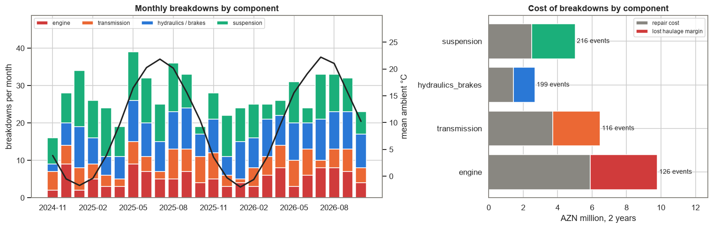
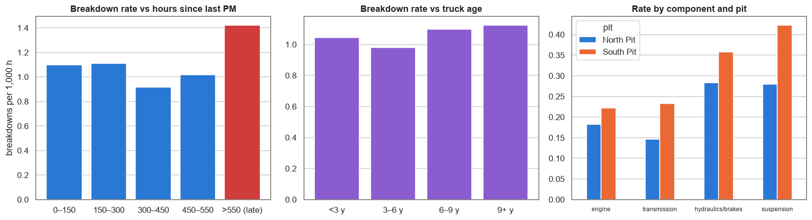
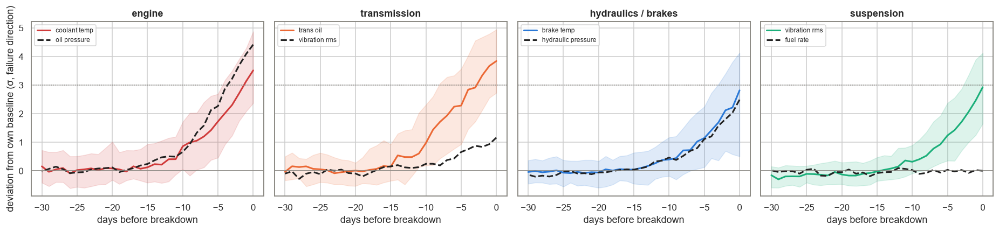
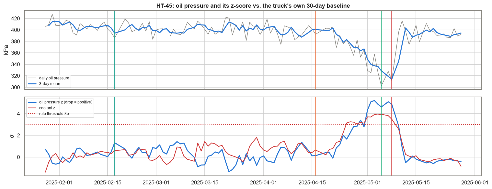
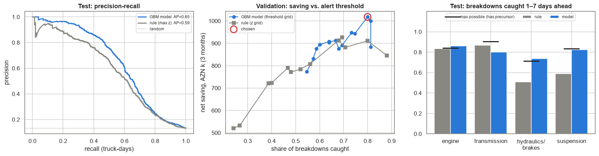
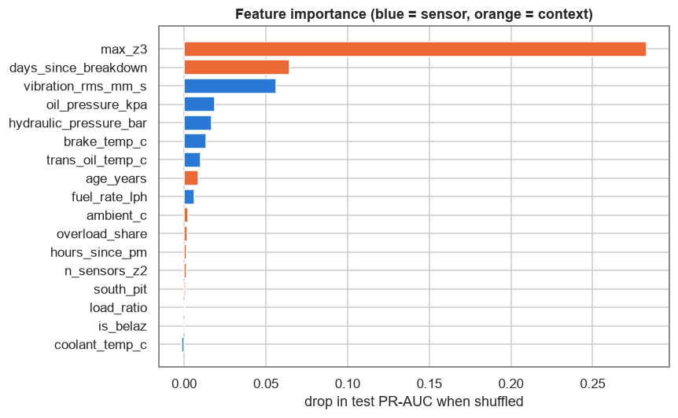

# Open-Pit Gold Mine — Haul-Truck Predictive Maintenance

**Daily Data Analytics Project · Day 15**

## Business question
An open-pit gold mine in western Azerbaijan runs **48 haul trucks** (CAT 777G, Komatsu HD785, BelAZ 7555B) on two pits, two shifts a day. Maintenance today means a PM service every ~500 engine hours, and everything else gets fixed after it breaks. Unplanned breakdowns stop ore haulage and cost far more than a planned repair. The maintenance manager asks: **how much do breakdowns cost, what drives them, do the trucks' sensors warn us in advance, and can a daily early-warning list catch failures early enough to pay for the extra inspections?**

What the project does:
1. Cleans two years of daily truck telemetry (32.9k truck-days, 7 sensors): unit mix-ups (°F), stuck sensors, messy truck IDs, mixed date formats, duplicates, weighing failures.
2. Reliability KPIs: availability, MTBF, MTTR, breakdowns per 1,000 h, and the cost of unplanned downtime.
3. EDA: which components fail, and how the breakdown rate depends on overdue PM, truck age and pit.
4. **Precursor analysis**: each sensor's deviation from the truck's *own* baseline, aligned on days-to-breakdown.
5. Baseline alerting: a **per-truck z-score control-chart rule**.
6. **Gradient-boosted early-warning model** (breakdown in the next 1–7 days), with a **time-based split and purge gap**. It is evaluated as *events* (inspections triggered, failures caught, lead time) and **in AZN**, with alert thresholds tuned on a separate validation period.
7. Today's watch list, findings and recommendations.

## Key KPIs (from the executed notebook)
| KPI | Value |
|---|---|
| Fleet / period | 48 trucks, Nov 2024 – Oct 2026 |
| Physical availability | 95.4% |
| Unplanned breakdowns | 657 (6.8 per truck per year) |
| MTBF / MTTR | 961 operating hours / 37.6 h |
| Breakdowns per 1,000 engine hours | 1.04 |
| Share of downtime that is unplanned | 63.5% |
| Cost of breakdowns (repair + lost haulage margin) | **AZN 11.98 M a year** (43% lost margin) |
| PM services done late (> 550 h) | **29.2%** of 1,127 PMs |
| Breakdown rate when PM is late vs on time | **1.42 vs 1.04** per 1,000 h |
| South Pit vs North Pit (suspension + transmission + brakes) | 1.01 vs 0.71 per 1,000 h |
| Failures with no sensor precursor (ground truth) | ~18% (29% of hydraulic/brake) |

### Cost by component
| Component | Breakdowns | MTTR | Cost per event (repair + lost margin) |
|---|---|---|---|
| Engine | 126 | 73 h | AZN 77.7k |
| Transmission | 116 | 57 h | AZN 55.8k |
| Suspension | 216 | 28 h | AZN 23.2k |
| Hydraulics / brakes | 199 | 15 h | AZN 13.5k |

### Early warning: rule vs. model (test period May–Oct 2026, thresholds chosen on Feb–Apr)
Ranking quality on truck-days: **PR-AUC 0.65 (model) vs 0.59 (rule)**, ROC-AUC 0.83 vs 0.81.

| Strategy | Inspections / week | Precision (alerts) | Breakdowns caught 1–7 d ahead | Median lead | Net saving / year |
|---|---|---|---|---|---|
| Rule, textbook 3σ | 5.5 | 65% | 56% | 3 d | AZN 3.85 M |
| Rule, **cost-tuned 2.5σ** | 7.0 | 60% | 66% | 4 d | **AZN 4.47 M** |
| GBM model, p ≥ 0.20 (max validation saving) | 12.0 | 42% | **80%** | 4 d | AZN 4.41 M |
| GBM model, p ≥ 0.38 (similar load to rule) | 8.6 | 56% | 76% | 4 d | **AZN 4.55 M** |

Net saving = 80% find rate × (breakdown cost − planned-repair cost) for caught failures − inspection cost. It is about **35–36% of the breakdown bill**.

## Charts
### What fails, when, and what it costs


### Drivers: late PM, age, pit


### Sensors drift days before a breakdown


### Per-truck control chart: an engine fault building up


### Model evaluation: PR curve, saving vs threshold, catch rate by component


### What the model looks at


## Findings & recommendations
| Area | Evidence | Recommendation |
|---|---|---|
| Cost of breakdowns | 657 breakdowns in 2 years, AZN 12.0 M a year; 43% is lost haulage, not parts | Report unplanned downtime hours as the headline maintenance KPI, next to availability |
| Late PM | 1.42 vs 1.04 breakdowns per 1,000 h when a PM is > 550 h late; 29% of PMs are late | Hard cap: no truck past 550 h without a PM; plan PM slots from the engine-hour forecast, not the calendar |
| South Pit | Suspension / transmission / brake failure rate 1.01 vs 0.71 per 1,000 h | Haul-road and ramp maintenance, and payload control (on-board weighing alert above 110%) on South Pit |
| Sensors warn early | Drift starts 10–15 days out and passes 2σ 2–6 days before most failures | Review telemetry every day, not only after a failure |
| Threshold choice | Textbook 3σ rule: AZN 3.85 M/yr; cost-tuned 2.5σ: AZN 4.47 M/yr | Tune alert thresholds on cost, not on statistical convention; re-tune every quarter |
| Rule vs model | At a similar inspection load the model catches 76% vs 66% of failures, but saves only ~2% more | **Go live with the tuned rule now** (no ML needed). Add the model where availability matters more than inspection hours: it catches far more hydraulic and suspension faults |
| Limits | ~18% of failures (hydraulic hose bursts most of all) have no precursor | Preventive hose replacement by hours; keep critical spares on site |

**Bottom line:** breakdowns cost this fleet about 12 M AZN a year, much of it in lost haulage. Two cheap fixes come first: **stop PMs from going late** and **control overloading on South Pit**. On top of that, the trucks' own sensors warn several days ahead of most failures, and a **per-truck z-score rule with a cost-tuned threshold** would save roughly a third of the breakdown bill. The gradient-boosted model ranks risk better and catches more failures, but most of its extra catches are cheap faults, so it adds availability rather than money. That is an honest result, and a good argument for starting simple.

*Caveats: synthetic data with a known structure; real precursors will be noisier. The money figures rest on stated assumptions: 420 AZN lost margin per truck-hour, an inspection costing 4 h of truck time + 300 AZN, an 80% find rate, and a planned repair costing 35% of the cost and 30% of the downtime of a breakdown. Inspections may also find faults other than the predicted one, which this evaluation ignores (a conservative choice).*

## Methods
- **Cleaning:** regex ID normalisation, dual-format date parsing, °F → °C detection (coolant > 150), **stuck-sensor detection** (≥ 5 identical consecutive readings), duplicate removal.
- **Reliability KPIs:** availability = 1 − (breakdown + PM downtime) ÷ calendar hours; MTBF = operating hours ÷ breakdowns; rates per 1,000 engine hours by exposure bucket.
- **Per-truck baselines:** trailing 30-day median and σ on rows t−37…t−8 (lagged so last week's drift is not absorbed); 3- and 7-day deviations in σ, signed in the failure direction; closed-form 7-day least-squares slope.
- **Precursor curves:** median and IQR of sensor z-scores aligned on days to the next breakdown, by component.
- **Model:** `HistGradientBoostingClassifier` (38 features, NaN-native), target = breakdown in 1–7 days; train Dec 2024–Jan 2026, validation Feb–Apr 2026, test May–Oct 2026, with a **7-day purge gap** before each cut.
- **Event-level evaluation:** each alert opens an inspection episode (7-day cooldown per truck); a breakdown counts as caught if an inspection happened 1–7 days before it; thresholds are chosen by **net AZN saving on the validation period**.
- **Permutation importance** (Δ PR-AUC on test), grouped by sensor.

## Tech stack
Python · pandas · NumPy · scikit-learn (HistGradientBoosting, PR/ROC metrics, permutation importance) · matplotlib · seaborn · nbformat / nbconvert

## Structure
```
data/generate_data.py                    synthetic telemetry + maintenance generator (seed 42) with injected data issues
data/telemetry_daily.csv                 32,882 raw truck-day rows: hours, payload, 7 sensors, ambient temperature
data/maintenance_log.csv                 1,835 events: PM services and breakdowns (component, downtime, cost)
data/fleet.csv                           48 trucks: model, payload class, commissioning date, pit
data/ground_truth.json                   true fault onset dates and lead times used by the generator
pdm.py                                   cleaning, maintenance context, rolling features, alert episodes, AZN evaluation
build_notebook.py                        builds the analysis notebook
haul_truck_predictive_maintenance.ipynb  executed analysis
images/                                  charts
```

## Run
```bash
pip install -r requirements.txt
python data/generate_data.py
python build_notebook.py
python -m nbconvert --to notebook --execute --inplace haul_truck_predictive_maintenance.ipynb
```

> **Note:** all data is synthetic (fixed random seed). It does not describe any real mine, company or fleet.

## 🇦🇿 Azərbaycanca xülasə
Qərbi Azərbaycandakı açıq karxana tipli qızıl mədəninin 48 karxana yük maşını üzrə 2 illik gündəlik telemetriya (sintetik data) əsasında **proqnozlaşdırıcı texniki xidmət** analizi aparılıb. Qəzalar ildə təxminən **12 mln AZN**-ə başa gəlir və bunun 43%-i itirilmiş daşıma marjasıdır. Hər 1000 motor saatına 1.04 qəza düşür. **PM-lərin 29%-i gecikir**, gecikən PM-dən sonra qəza tezliyi 1.42-yə qalxır. South Pit-də asqı, transmissiya və əyləc qəzaları 40% çoxdur. Sensorlar (yağ təzyiqi, soyuducu temperaturu, transmissiya yağı, əyləc temperaturu, vibrasiya) qəzadan **10–15 gün əvvəl** sürüşməyə başlayır. Hər maşının öz bazasına nisbətən **z-score qaydası** və **gradient boosting modeli** müqayisə olunub; hədlər AZN qənaətinə görə validasiya dövründə seçilib. Nəticə: xərcə görə tənzimlənmiş 2.5σ qaydası qəzaların 66%-ni əvvəlcədən tutur və ildə ~4.5 mln AZN qənaət verir. Model qəzaların 76–80%-ni tutur, amma əlavə tutduqları ucuz nasazlıqlar olduğu üçün pul qənaəti demək olar ki eynidir. Tövsiyə: əvvəlcə PM gecikmələrini dayandırmaq və sadə qaydanı işə salmaq, modeli isə texnika hazırlığını artırmaq üçün sonra əlavə etmək.
